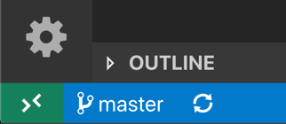
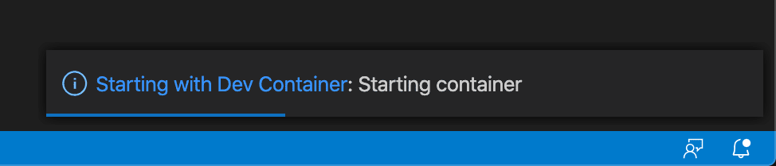

# Building Marlin in a VSCode Dev Container

A dev container is a pre-built Docker environment with all the dependencies needed to build Marlin in VSCode.
It sets up both the build environment and the VSCode extensions, so VSCode is ready to build and upload Marlin
without installing any toolchains on your computer. Marlin's container is defined in its `.devcontainer/` folder.

See the official [Dev Containers documentation](//code.visualstudio.com/docs/devcontainers/containers) for details.

## System requirements

- **Windows:** [Docker Desktop](//www.docker.com/products/docker-desktop) with the [WSL 2 back-end](//aka.ms/vscode-remote/containers/docker-wsl2).
- **macOS:** [Docker Desktop](//www.docker.com/products/docker-desktop).
- **Linux:** [Docker CE/EE](//docs.docker.com/install/#supported-platforms) and [Docker Compose](//docs.docker.com/compose/install). (The Ubuntu snap package is not supported.)
- [VSCode](//code.visualstudio.com/docs/setup/setup-overview) with the **Dev Containers** extension.

## Getting started

1. Start VSCode, run the **Dev Containers: Open Folder in Container...** command from the Command Palette (F1) or the
   quick actions Status bar item, and select the Marlin project folder.

   

2. VSCode reloads and starts building the dev container. A notification shows its progress. The container is only
   built the first time; opening the folder later is much quicker.

   

3. When the build completes, VSCode connects to the container automatically.

You can now work with the project just as you would locally, including building with
[Auto Build Marlin](/docs/basics/install_abm.html). From now on VSCode reuses the dev
container whenever you open the folder.

Bind-mounting the local filesystem into a container is convenient, but has some performance overhead on Windows and
macOS. There are [ways to improve disk performance](//code.visualstudio.com/remote/advancedcontainers/improve-performance),
or you can open the repository in an isolated container volume instead.

## When to use a dev container

Choose the dev container if you want to build Marlin without installing a toolchain on your computer, or if you want
every build to use the same environment. If you already have PlatformIO working in VSCode, the
[PlatformIO VSCode guide](/docs/basics/install_platformio_vscode.html) does the same job without Docker.

## What the container includes

The container is defined by two files in Marlin's `.devcontainer/` folder: `devcontainer.json`, which lists the
VSCode extensions, and a `Dockerfile` that builds the image. The extensions that `devcontainer.json` installs are:

- **PlatformIO IDE** (`platformio.platformio-ide`), for building and uploading.
- **Auto Build Marlin** (`marlinfirmware.auto-build`), for building with a configuration you choose.
- **Python** and **Pylance** (`ms-python.python`, `ms-python.vscode-pylance`), for editing Python in the project.
- **EditorConfig** (`editorconfig.editorconfig`), which applies the project's `.editorconfig` settings (trailing
  whitespace removed, final newline inserted) to your edits.

Because the extension list lives in the repository, every clone of Marlin gets the same set when it opens in a
container.

## Troubleshooting

| Symptom | Likely cause | What to do |
|---|---|---|
| VSCode says it cannot find a container runtime | Docker is not running | Start Docker Desktop (or the Docker service on Linux), then run the command again. |
| The first build takes a long time | The image is being built for the first time | Wait for the progress notification to finish. Later opens reuse the image. |
| Builds are slow on Windows or macOS | Bind-mounted files | See the disk performance link above, or use an isolated container volume. |
| The Ubuntu `snap` version of Docker does not work | Snap packages are not supported | Install Docker CE from Docker's own repository. |

If the container will not start at all, use [Auto Build Marlin](/docs/basics/install_abm.html) or the
[command-line install](/docs/basics/install_cli.html) instead, and keep the container for when the problem is fixed.
